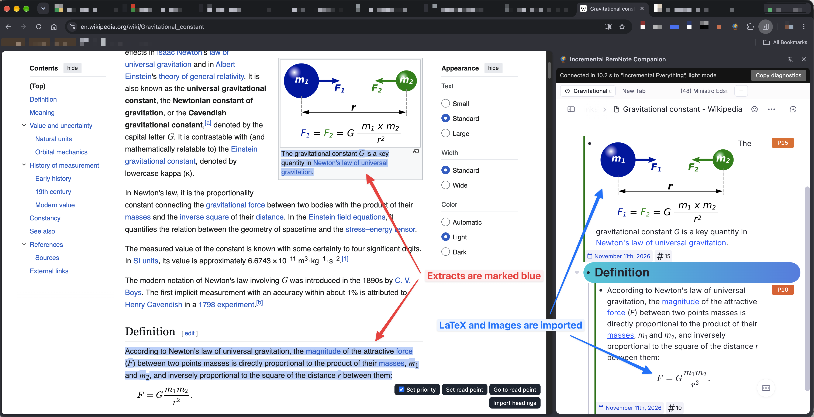
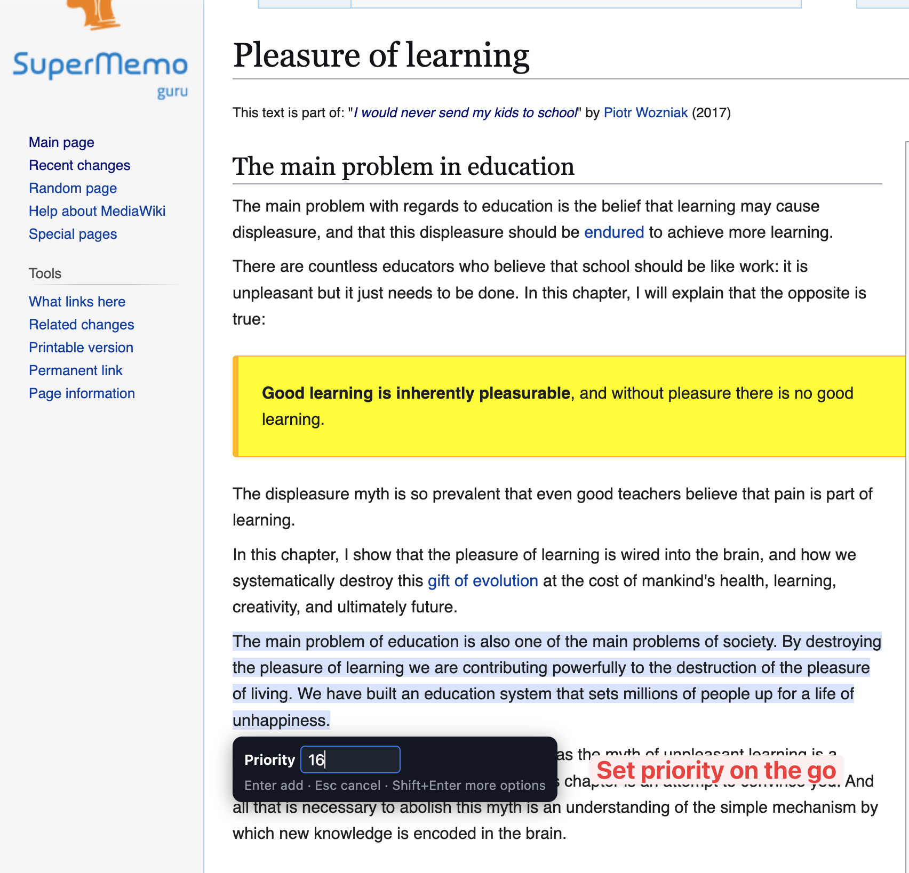
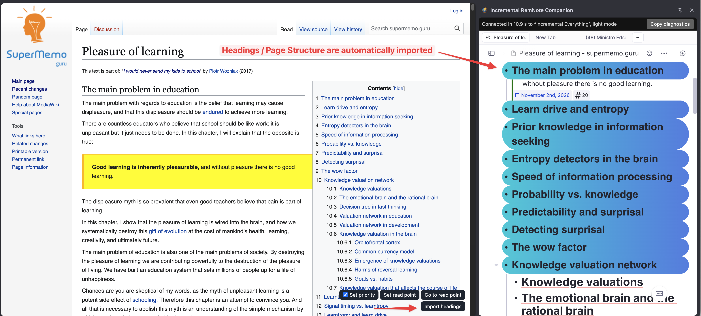

# Chrome Companion Extension

Read web pages incrementally right in Chrome. **Incremental RemNote Companion** turns text you select on a page into Incremental Rems, keeps what you have extracted highlighted on the page, and remembers where you stopped reading.

It works together with the plugin, through RemNote open in Chrome's side panel.

## What you need

- **Chrome on a computer**, or another Chromium browser. It doesn't work on phones.
- **The Incremental RemNote plugin**, version 1.0.185 or later, installed from the [plugin marketplace](https://www.remnote.com/plugins/incremental-everything).
- **A RemNote account, signed in on www.remnote.com in the same browser.** The panel opens whichever knowledge base this browser used last.

## Setting it up

1. Install the extension. It is on its way to the Chrome Web Store. Until then, download this repository, open `chrome://extensions`, turn on **Developer mode**, click **Load unpacked**, and choose the `companion` folder.
2. Pin it to the toolbar, and reload any pages you already had open.
3. Open a web page and click the extension's globe icon. The panel opens with RemNote on that page's document, the same one the RemNote Clipper uses, and says **Connected** at the top once the plugin is ready.

The first connection takes a while, as RemNote and your plugins have to start. A larger knowledge base takes longer. You can keep working in the meantime, as nothing you do on the page is lost.

If you also use the RemNote Clipper, close its panel while using this one.

## The bar

A small bar stays at the bottom right of every page, with the panel open or closed:

| Control | What it does |
|---|---|
| **Add Extract** | Appears when text is selected, and makes it an extract |
| **Set priority** | When ticked, each extract asks for its priority. It stays as you left it, on every page |
| **Set read point** | Remembers the top of the window as your place on this page |
| **Go to read point** | Scrolls back to that place |
| **Import headings** | Adds the page's sections to its document |

## Extracts

Select text and press **`Opt+X`** (`Alt+X` on Windows), or click **Add Extract**. The selection becomes an Incremental Rem and turns blue on the page. Bold, italics, links, images and formulas in the selection come along, with formulas as real LaTeX on sites such as Wikipedia. Images stay on their original website, so one disappears from your Rem if the site removes it. To keep a copy in RemNote, use [Store Linked Images & Audio](Utilities-Cleaning-Up.md#store-linked-images-audio).

Extracts go in the page's document, which RemNote keeps in its `Links` folder until you move it. The document itself isn't made Incremental, so use [Make Incremental](Getting-Started.md#making-a-rem-incremental) on it if you want it in your queue as well.

`Opt+X` is left alone when no text is selected, or inside a text box, so it still types `≈` there.

## Setting a priority

Press **`Opt+Shift+X`** (`Alt+Shift+X` on Windows), or use Add Extract with **Set priority** ticked. A small field beside the selection asks for this extract's priority:

| Key | What it does |
|---|---|
| A number, then **Enter** | Adds the extract with that priority, from 0 to 100 |
| **Enter** on an empty field | Adds it with the inherited priority |
| **↑ / ↓** | Changes the number by one |
| **Esc** | Cancels, and gives your selection back |
| **Shift+Enter** | Adds it and opens the full [priority popup](Prioritization-&-Sorting.md) in the panel, for the interval and scheduler |

The full popup needs one click in the panel before you can type, because Chrome doesn't let an extension move the keyboard there from the page.

## Sections of the page

**Import headings** creates the page's headings as nested Rems in its document, in the page's order.

Extracts go under the section they came from, and stay in reading order however you add them. If you haven't imported the headings, the extract's own section is created when it's needed, so importing is optional.

Pages whose headings aren't real headings have no sections to import. Extracts from them go straight under the document.

## Highlights and the read point

Highlights and the orange read point come back whenever you return to a page, and they don't change the page itself. Deleting an extract's Rem removes its highlight the next time the page loads with the panel connected.

They are found again by their text. If a page has changed so much that an extract's text is gone, a message says how many highlights couldn't be placed. A read point whose text has gone falls back to its old scroll position.

## With the panel closed

The bar keeps working. Extracts, read points and imports wait in the browser, with a count on the toolbar icon, and reach RemNote when you next open the panel. Highlights are kept in the browser too, so they still appear.

**Shift+Enter** in the priority field opens the panel by itself, since the full popup lives there.

## Limits

- It works on ordinary web pages, not on Chrome's PDF viewer or internal pages.
- `Opt+X` and `Opt+Shift+X` can't be changed yet. When text is selected, they take priority over a site's own use of those keys.
- Extracts made on another computer show their highlights here once the page loads with the panel connected.
- Addresses count as the same page in the same way as for the [duplicate web page warning](Getting-Started.md#duplicate-web-page-warning), so a `#section` link leads to the same highlights.

## Privacy

The extension has no server, and nothing goes anywhere except your own browser and your RemNote account. See the [privacy policy](Companion-Privacy-Policy.md).
