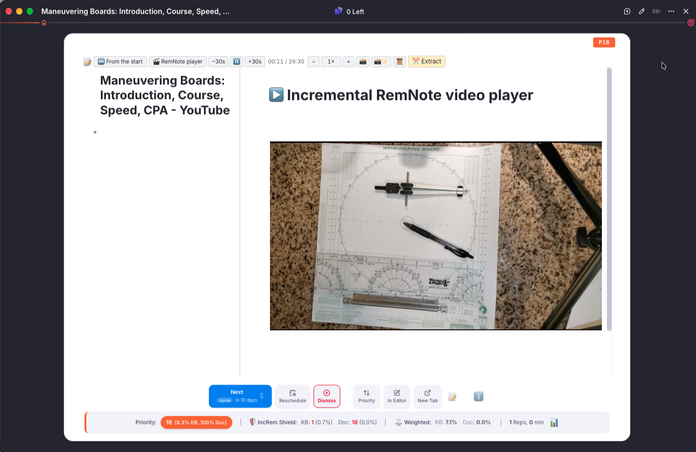

# Incremental Video

## The Philosophy of Incremental Video

Video is one of the richest sources of knowledge available today. Lectures, tutorials, talks, and documentaries carry information that can't always be captured by reading alone — tone of voice, visual demonstrations, and live reasoning all contribute to deeper understanding.

However, watching a full video in a single sitting often leads to the same problem as traditional reading: **massive input with poor retention**. Most of what we watch is forgotten within days. Even worse, we tend to re-watch entire videos just to find a single passage that mattered.

**Incremental Video** applies the principles of [incrementalism](What-is-Incrementalism%3F.md) to video content. Instead of watching a video from start to finish, you:

1. **Watch in segments** — process a video gradually across multiple review sessions
2. **Extract key passages** — mark important segments with precise start/end times
3. **Prioritize what matters** — assign priorities so the most important segments surface first
4. **Interleave with other material** — mix video segments with readings, flashcards, and notes in a single session

This mirrors how incremental reading breaks articles into manageable extracts. The goal is the same: **fluent transition from passive consumption to active retention**, guided by priorities.

In [SuperMemo's terminology](https://help.supermemo.org/wiki/Incremental_video), incremental video ensures that "the student can process far more video material than conventional viewing can allow" — because the student is always reviewing the *most important* segments first, at optimum intervals, rather than rewatching entire videos.

---

## What you can watch { #what-you-can-watch }

| Video | How it gets into RemNote | Players |
|---|---|---|
| **A RemNote video** | **Create › Upload File › Paste YouTube URL**, RemNote's own way of adding a YouTube video | The plugin's player **and** RemNote's player, with a button to switch |
| **A video saved with the Clipper** | The [RemNote Clipper](https://chromewebstore.google.com/detail/remnote-clipper/lpnnhhkdbmobjiheokoonjlmaffljcng) browser extension, which saves the YouTube link | The plugin's player |
| **A video file on your computer** | [Import Local Videos](#local-videos) or [Link Local Video](#link-local-video) (desktop, with the [helper](#setup)) | The plugin's player for local files |

Make the Rem Incremental as any other (`Alt+X`), and it comes up in the queue with its player.

---

## Two players { #two-players }

### The plugin's player { #plugin-player }

Built for incremental watching:

- **Resumes where you stopped.** Each video remembers its position across sessions; the **⏮ Resumed at 12:34** chip takes you back there if you wander off.
- **Controls**: −30 s, play/pause, +30 s, and speed in steps of 0.25× (click the speed for 1×). Each video remembers its speed.
- **✂️ [Video Extracts](#video-extracts)** with an exact start and end, which **pause by themselves at their end**.
- **📸 [Screenshots](#screenshots)** and **📜 [transcripts](#transcripts)**.
- **Notes beside the video** (📝 shows or hides them). Drag the divider to resize, or focus it and use `←` `→`; the split is remembered on each device. For a RemNote video, the notes are the Rem's children under its name.

{ width="900" }

To show a YouTube video, the plugin keeps one document in your knowledge base, **▶️ Incremental RemNote video player**. Leave it there; if it is deleted, it is made again the next time a video plays.

### RemNote's player { #remnote-player }

RemNote's video page, with its **transcript, Highlight Moment, AI Tutor and Summary**. It is offered for RemNote videos only. The plugin can follow where it is playing, about every 3 seconds, but can't move or pause it. In its top bar the plugin adds:

- **✂️ Extract**, which takes its times from RemNote's player, with −5 / +5 s nudges because the position lags by up to 3 seconds;
- **📜** for the transcript.

The plugin's position is offered to RemNote's player as its **"Resume watching at…"** button, and whatever RemNote's player plays is copied back. So both players resume from the same place. (RemNote shows that button once it has played the video at least once.)

### Switching { #switching }

On a RemNote video, each player has a button in its top bar to switch to the other: **🎬 RemNote player** / **▶️ Plugin player**. The switch applies to that card only. Which one opens first is the setting **Default Player for RemNote Videos** (default: the plugin's player). An extract always opens in the plugin's player first, because only it stops at the extract's end.

---

## Video Extracts { #video-extracts }

A Video Extract is a passage of a video, with its own priority, schedule and notes. It is an Incremental Rem placed under the video, named after its range: `Video Extract [11:40 – 11:57]`.

### Making an extract { #making-an-extract }

**In the plugin's player:**

1. Click **✂️ Extract** where the passage begins: `▶ Start: 11:40 → now: 11:52` follows the video.
2. Click **Set End** where it ends. The video pauses, and the extract is created.

**In RemNote's player:**

1. Click **✂️ Extract**: the start is where RemNote's player is now. Adjust it with **−5 / +5**.
2. Click **■ Set End** where it ends, adjust it the same way, then **✓ Create**.

Either way, the extract gets its **transcript** under it when the [helper](#setup) can fetch it, then a **title** from that transcript ([below](#extract-titles)), and the priority popup opens.

[](https://youtu.be/o5I-UL9SG0E)

*Recorded with an earlier version of the player.*

### Reviewing an extract { #reviewing-an-extract }

- In the plugin's player, the extract plays its range and **pauses at its end** (*✓ end of extract reached*). **🔄 Replay** starts it over.
- In RemNote's player, the bar shows *ends at 11:57 · now 11:50*, then *✓ end of extract reached*: RemNote's player can't be stopped there.
- **An extract resumes where its last review stopped**, with a **⏮ Resumed at** chip. Once a review gets to the end (or to its last 5 seconds), the next one starts from the beginning again. Going **In Editor** from the queue continues from where you are.

### Extracts of extracts { #extracts-of-extracts }

An extract of **1.5 minutes or more** shows **✂️ Extract** itself, in every player, so a long passage can be cut down further. The new extract goes under the one it was cut from. Its marks aren't held inside the parent's range.

### Titles from the transcript { #extract-titles }

Once an extract has its transcript, Claude reads it and adds a short title after the range, in the language of the video:

`Video Extract [11:40 – 11:57] — Questão 28 polêmica do RIPEAM: erro entre Master Heads e Mast Heads`

So a list of extracts of one video says what each is about. The title arrives a few seconds after the transcript, behind the priority popup. An extract you have renamed is never retitled, even if you rename it while Claude is answering. It needs the [helper](#setup) with Claude Code; turn it off with **Title Video Extracts with Claude**.

---

## Reviewing in the Editor { #review-in-editor }

**In Editor** (`Ctrl+Shift+J`) works for videos too, with the [Editor Review Timer](Reviewing-Items-in-the-Editor.md):

- **A RemNote video** opens on RemNote's video page, offered your position to resume at. Its timer controls come in a **floating bar** at the bottom right, since the timer bar can't show on that page: the time, where the player is (🎬), **✂️ Extract**, **📜**, **⏸**, **Next**, **End & Back**, **End** and **Dismiss**.
- **An extract of a RemNote video** opens with the video's page beside it, offered the extract's own resume point. The floating bar shows the extract's range and when its end is reached. An extract cut from another extract opens as its own page, and the video's page opens in a pane to its right.
- **A local video, or an extract of one,** opens as its own page with the [plugin's player](#plugin-player) under its title; the document is the notes. It starts playing when you're reviewing it, and stays paused when you just open the Rem.
- A video saved with the Clipper opens as RemNote shows its link; the plugin's player for it is in the queue.

---

## Where you stopped, in the history { #history }

Each review records where the video was left in the [Repetition History](Repetition-History-and-Statistics.md#notes-and-where-you-stopped) (`Ctrl+Shift+H`), on the line under the review's row, as PDF reviews record the page:

| Line | Meaning |
|------|---------|
| `▶ 1:42 of 1:26–2:04` | An extract, stopped at 1:42 within its range |
| `▶ 2:01 of 1:26–2:04 · ✓ end` | An extract watched to its end (or its last 5 seconds) |
| `▶ 12:34 / 45:00 (28%)` | A whole video, with its length |
| `▶ 12:34 · 1.5×` | A whole video whose length isn't known, played at 1.5× |

- The time is the one the next review resumes from, so the rows show how far each session got.
- The **length** is known only for RemNote videos that RemNote's player has opened. YouTube links and local videos show the time alone.
- The **speed** is the plugin's player's, shown when it isn't 1×. A session in RemNote's player at another speed still shows the plugin's.
- In the queue, the position is saved at once when you pause and every 5 seconds while playing. Pressing **Next** while it plays can record a time a few seconds behind; pause first for the exact one.

---

## Screenshots { #screenshots }

In the plugin's player, **📸** saves the current frame under the Incremental Rem, in a Rem named after the time (`📸 12:34`). **📸✨** also transcribes the frame — slide text, formulas, diagrams' labels — into an outline under it, with Claude. Screenshots are taken by the [helper](#setup) from the video itself, at the exact time.

---

## Transcripts { #transcripts }

**📜** in any player, the floating bar, or the commands **Add Video Transcript** (`avt`) and **Add Video Transcript from Audio** (`avta`) writes the transcript of what you're watching:

- **A whole video**: a **📜 Transcript** Rem with blocks of about 600 characters, each starting with its time.
- **An extract**: blocks of about 300 characters of its range, under the extract. New extracts get theirs automatically.

The commands work on the queue item, the focused Rem, the Rem under review or an open pane's Rem, and from a note inside a video or extract.

Where the text comes from:

1. **The uploader's captions** in the video's own language.
2. Else **YouTube's automatic captions** in that language, never a translation. Claude tidies them — punctuation, sentences, words the recognition clearly got wrong, key terms in **bold** — with **Tidy Automatic Captions with Claude**. The raw text is written first and replaced as it is tidied.
3. Else, or with `avta`, **the audio, transcribed by Whisper on your computer**. A local video is always transcribed this way. On an Apple M4 Pro, a minute of audio takes about 4 seconds, and a 43-minute lecture about 2 minutes, download included.

---

## Local videos { #local-videos }

Video files on your computer or an external disk — a course you downloaded, recorded classes — play in the plugin's player with everything above: resume, speed, extracts, screenshots and transcripts from the audio. **Desktop app on macOS, with the [helper](#setup).**

### Importing a folder { #import-local-videos }

Run **Import Local Videos** (`ilv`) and pick a folder in the dialog. The popup shows how many videos it holds, its subfolders and how many are already in RemNote, and asks:

- **Where**: inside the focused Rem, or as a new top-level document.
- **Make them Incremental Rems**, with which **priority**.
- **When they're due**: all today, or the first today and **one more every N days**, in file order — a course becomes a lesson a day.

It creates a document named after the folder, a Rem per subfolder and one per video, in natural order (*Aula 2* before *Aula 10*). Importing the folder again adds only the videos that are new.

### Linking one file { #link-local-video }

**Link Local Video** (`llv`) picks one file for the focused Rem, names the Rem after the file if it is empty, and makes it Incremental.

### Libraries, disks and formats { #libraries }

- Each folder you pick becomes a **library**, and each video remembers its library and its path inside it. Videos can live in several places.
- **If a disk isn't connected**, the player says so. If the folder has moved, click **📁 show where it is now** once, and every video in that library plays again.
- If the helper isn't running, or the file is gone, the player says that too.
- Formats: **MP4, M4V, MOV and WebM** in the codecs RemNote's browser engine plays — H.264 and HEVC both work on macOS.
- The helper only ever reads video files inside your libraries, and web pages can't read them through it.

---

## Setting up the helper for video { #setup }

Screenshots, transcripts, titles and local videos run through the **local helper** that also does [AI Transcription of PDF Highlights](AI-Transcription-of-PDF-Highlights.md). The players themselves, extracts and resuming need nothing.

1. **Set up the helper** as described in [Setup](AI-Transcription-of-PDF-Highlights.md#setup), with [start at login](AI-Transcription-of-PDF-Highlights.md#run-at-login) on macOS. Claude Code is needed for 📸✨, tidying and titles.
2. **For YouTube screenshots and transcripts**, and for local videos:

    ```bash
    brew install yt-dlp ffmpeg
    ```

3. **For transcripts from the audio** (videos without captions, `avta`, local videos):

    ```bash
    brew install whisper-cpp
    mkdir -p ~/.incremental-remnote/ai-ocr/whisper
    cd ~/.incremental-remnote/ai-ocr/whisper
    curl -LO https://huggingface.co/ggerganov/whisper.cpp/resolve/main/ggml-large-v3-turbo-q5_0.bin
    curl -LO https://huggingface.co/ggml-org/whisper-vad/resolve/main/ggml-silero-v5.1.2.bin
    ```

    The first file is the speech model (574 MB). The second (under 1 MB) skips silence and music, where Whisper would otherwise invent words, and halves the time.

4. **Restart the helper** (`launchctl kickstart -k gui/$(id -u)/com.incrementalremnote.ai-ocr-helper`, or stop and start it in its terminal).

Open <http://127.0.0.1:3457/> to check: `ytDlp`, `ffmpeg` and `whisper` say where each was found, and `localVideo` is `true`.

!!! note "If you set up the old transcript proxy"
    Earlier versions fetched transcripts through a separate proxy (`yt-local-proxy.js`, port 3456), which YouTube now refuses. The helper replaces it. Remove the proxy's login item:

    ```bash
    launchctl bootout gui/$(id -u)/com.incrementaleverything.yt-transcript-proxy
    rm ~/Library/LaunchAgents/com.incrementaleverything.yt-transcript-proxy.plist
    ```

The instructions Claude follows are files you can edit, next to the PDF one: `transcript-prompt.md` (tidying captions) and `extract-title-prompt.md` (titles), in `~/.incremental-remnote/ai-ocr/`.

---

## Settings { #settings }

In the plugin settings, group **Incremental Video**:

| Setting | Default | What it does |
|---|---|---|
| **Default Player for RemNote Videos** | The plugin's player | Which player a RemNote video opens in, in the queue. The card's switch overrides it for that card. |
| **Tidy Automatic Captions with Claude** | On | Claude tidies transcripts that come from YouTube's automatic captions. |
| **Title Video Extracts with Claude** | On | Claude adds a title to each extract from its transcript. |

---

**See also:**

- [What is Incrementalism?](What-is-Incrementalism%3F.md)
- [Reviewing Items in the Queue](Reviewing-Items-in-the-Queue.md)
- [Reviewing Items in the Editor](Reviewing-Items-in-the-Editor.md)
- [PDF Incremental Reading Workflow](PDF-Incremental-Reading-Workflow.md)
