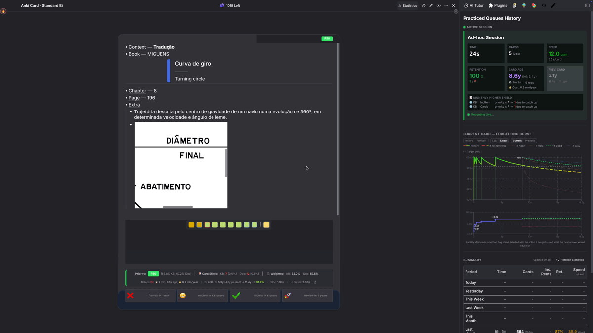

# Cleaning Up

Commands that clear out Rems an import left behind, find flashcards that cannot be practised, store the images and audio a Rem only links to, and repair references an import broke.

## Delete Empty Extra Card Detail Rems

**`Delete Empty Extra Card Detail Rems`** (`quick: decd`) finds Rems tagged **Extra Card Detail** that hold *nothing at all*, and deletes them once you have confirmed the count.

### Why they exist

They come from **Anki imports**. Anki's *Extra* / *Back Extra* field is HTML, where a paragraph break is a structural element rather than a character. An importer that maps that field onto RemNote's **Extra Card Detail** powerup therefore creates a child Rem for every `<br>` and `</p>` — and the ones carrying no text arrive as Rems holding literally nothing.

In the outline they are easy to miss — a pair of blank bullets among the green ECD ones, betrayed only by the `✎ ✕` controls sitting on otherwise empty rows:

{ width="800" }

In the **queue** they are not missable, because every item shown has to be named and these have no name — so each one surfaces as **Unnamed** while you review.

### Why the normal search cannot find them

RemNote's search indexes **text**, and these Rems have none. Neither `Ctrl+F` nor a query can isolate a Rem by its emptiness.

Asking the **Extra Card Detail** powerup for its members does not work either — RemNote does not expose membership for its *built-in* powerups, so that list comes back nearly empty on a knowledge base full of them. (The same limitation shows up elsewhere in this plugin, with PDF Highlights and uploaded files.)

So the command works by **walking the scope and asking each Rem directly** whether it carries the powerup. That sounds expensive and is not, because of the order it works in: whether a Rem is blank is readable without asking RemNote anything, so the blank test runs first and reduces a whole knowledge base to the few Rems worth a question.

### How to use it

Run it from the omnibar. Two scopes, as with the image scan:

* **This Rem and its descendants** — the focused Rem, or the open document when the cursor is not in a Rem.
* **The whole knowledge base** — every Extra Card Detail Rem there is.

**The scan writes nothing.** It reports what it found and waits; nothing is deleted until you press the red button.

### What counts as empty

The bar is set high on purpose, because this command *deletes*.

!!! warning "Blank text is not the same as empty"
    Some Rems hold **no text at all and are still doing something** — a **portal** is the clearest case: it has no text of its own because it is a window onto other Rems, and its contents are not its children either, so neither a text test nor a child test notices it. The signal is the Rem's *type*, which is why the checks below start there. This was found the hard way, by a scan that offered a portal as "safe to delete".

A Rem is only a candidate when **every one** of these holds:

* **It is a plain Rem.** Not a **portal**, not a **table** (nor a row or cell of one), and not a **Concept**, **Descriptor**, slot, powerup property or document. A typed Rem with no text is someone's unfinished structure, not import debris.
* **It carries no other RemNote powerup.** Every built-in powerup is asked about individually, because several of them — **divider**, **embedded website**, **search portal**, **code block**, **uploaded file**, **table of contents** — render real content while holding no text at all, and RemNote does not list built-in powerups among a Rem's tags.
* **No text and no back text.** Blank means blank after whitespace, `&nbsp;` and zero-width characters are discounted — but an image, a Rem reference, LaTeX, audio, a drawing or an annotation counts as content even with no letters around it. Purely cosmetic formatting (bold, italic, highlight, colour) on nothing is still nothing; a **cloze**, a **link** or a **comment** is not, even when it renders as empty.
* **No children.** Deleting a Rem takes its descendants with it, so a blank Rem with anything underneath it is never touched.
* **It displays nothing.** Asked directly whether it includes any Rem the way a portal does — a second guard behind the type check, since this is the mistake with the worst consequences.
* **No tag or powerup other than Extra Card Detail.** Anything else is a mark somebody put there deliberately.
* **Nothing references it**, it has **no flashcards of its own**, **no source**, and **no alias**.

Anything that fails a check is **kept and counted**, with the reason shown — so a run that deletes fewer Rems than you expected explains itself rather than leaving you guessing.

### Confirming before the delete

The review screen gives you the numbers first:

* the **funnel** — how many Rems were walked, how many hold nothing, and how many of *those* carry Extra Card Detail — so a surprising result shows you which stage it narrowed at,
* how many are completely empty and safe to delete,
* how many were kept, broken down by reason,
* a **sample of what will go**, listed by the Rem each blank sits under — so you can recognise the documents involved before agreeing,
* a rough estimate of how long deleting will take.

`Enter` deliberately does **not** trigger the delete. It ran the scan on the previous screen, and carrying that reflex into an irreversible action is the mistake the two-stage flow exists to prevent — the red button has to be clicked.

### If you need something back

**A manifest is written before anything is deleted.** Every candidate's id, and the id and text of the Rem it sits under, are saved to this device *and* offered as a **JSON file download**. If neither can be written, the run stops and deletes nothing — the same rule the [card-priority migration](Changelog.md) follows.

That manifest is the recovery path worth relying on. The Rems themselves hold nothing, so what you would ever need back is the knowledge that one existed and *where* — which is exactly what it records. Every id is also written to the developer console before removal.

Whether RemNote's own trash retains plugin-deleted Rems is not something this page will promise; treat the manifest as the backup and, for a large run, take a knowledge-base export first.

### How long it takes

The **scan is quick**, even across a whole knowledge base: reading every Rem takes seconds, the blank test costs nothing on top of that, and only the blank Rems pay for a question to RemNote. **Deleting is the slow part**, at roughly a tenth of a second per Rem, because RemNote applies deletions one at a time. The review screen estimates it before you commit; a few hundred Rems is under a minute, and several thousand is worth starting when you can leave the popup open.

!!! tip "Leave it running"
    The work lives inside the popup. Closing it mid-delete stops the run — Rems already deleted stay deleted, and running the command again clears the rest.

---

## Card Enablement Audit { #card-enablement-audit }

**`Audit Card Enablement (tagged / referencing / descendants)`** takes one anchor Rem, asks every Rem in its orbit whether it actually produces flashcards, and lets you switch the broken ones back on in bulk.

### The problem it solves

A Rem can look exactly like a flashcard — a front, a back, a cloze — and generate **nothing**. There are several ways that happens, and RemNote shows none of them in the outline:

* the **flashcard direction** is set to `none`, so neither the forward nor the backward card exists;
* **Enable Cards** is off on the Rem itself;
* an ancestor carries **Disable Descendant Cards**;
* the Rem is a **table** or sits inside one — RemNote ships table rows with cards off;
* its **clozes** were switched off — one at a time in the queue, or all at once with RemNote's `/Disable All Cloze Cards`.

The one that arrives in bulk is the first. An **Anki import** can land hundreds of Rems at `enablePractice=true, practiceDirection=none` — they read as perfectly ordinary flashcards and are simply never scheduled.

!!! warning "These Rems are invisible to every other tool"
    A Rem whose direction was set to `none` before any card was made owns **no card records at all**. It therefore produces no rows in the card table, which is what the [Suppressed Cards](Prioritization-&-Sorting.md#suppressed-cards) breakdown is built from — so no amount of filtering there will ever show it. RemNote's own search cannot express the question either, because there is no text to match on.

    This audit works the other way round: it starts from a **set of Rems** and asks each one what it generates. A Rem with no cards at all is a result, not an absence.

### Choosing what to audit

The anchor is the focused Rem (or the document you ran the command from). Four checkboxes decide the population, and they combine freely:

* **Tagged with it** — every instance of the anchor used as a tag.
* **Referencing it** — every Rem whose text links to the anchor.
* **Its descendants** — the anchor itself and everything underneath it.
* **Expand each match** — add every match's own subtree.

That last one is usually what reaches an imported deck: the tag or the reference sits on the container, while the Rems that own the cards are its children.

### Reading the results

Each Rem gets one **verdict**, shown as a coloured chip you can click to filter the list. The panel opens showing the two that are worth hunting.

| Verdict | Meaning | Fixable here |
| --- | --- | --- |
| `dir=none` | Has card material, practice is on, no direction enabled | ✅ |
| `practice off` | **Enable Cards** is off on the Rem | ✅ |
| `table` | The Rem is a table or sits in one | ✅ |
| `ancestor off` | An ancestor carries **Disable Descendant Cards** | ❌ — untag the ancestor |
| `paused deck` | Inside a paused deck | ❌ — unpause the deck |
| `clozes off` | Every cloze on the Rem is switched off, so it produces nothing | ❌ — see below |
| `some clozes off` | Still producing cards, but some of its clozes are switched off | ❌ — see below |
| `not surfaced` | Nothing surfaces and no Rem-level flag explains it | ❌ — the markup is probably gone |
| `no material` | No back side, no clozes, no card records | ❌ — not a flashcard |
| `OK` | Producing cards | — |

Every row shows both the cards currently **surfaced** and the card **records** that exist, as `surfaced/records`. Those two numbers are what separate a Rem whose cards were switched off from one that never had any — `rem.getCards()` alone cannot tell them apart.

The verdicts are ordered by what a fix would actually accomplish, so a Rem under a disabling ancestor is reported as `ancestor off` rather than `dir=none`: setting a direction there writes the flag and still produces nothing.

!!! warning "Switched-off clozes can only be undone inside RemNote"
    RemNote keeps a Rem's disabled clozes in a list on the Rem itself, and it exposes that list to **no plugin** — it cannot be read or written from here. The audit works it out indirectly, from the card records that exist but never surface, and reports it as `clozes off` / `some clozes off` with a count in the `surfaced/records` column (`0/1 · 1c (1 off)`).

    **Switching cards ON will not bring them back.** That writes the *Enable Cards* flag and leaves the cloze list untouched, so the Rem still produces nothing — and RemNote's own `/Enable Cards` command behaves exactly the same way. This catches people out, which is why the panel says so on screen rather than offering a button.

    Click the row to open the Rem, then run RemNote's **`/Enable All Cloze Cards`** there — or click a greyed-out cloze and choose **Enable this card** for just one.

    A Rem is only given one of these verdicts once everything else has been ruled out. A disabling ancestor or a paused deck hides *every* card on a Rem, which would make each of its clozes look individually switched off; those Rems are reported by their real cause instead.

### Fixing them

Tick the rows you want — the panel pre-selects exactly the fixable ones in the default filter — pick an action, and apply.

* **Set flashcard direction** → `forward` (the default), `both`, `backward` or `none`.
* **Switch cards ON** / **Switch cards OFF**.

`↑`/`↓` move, `Space` selects, `A` selects everything shown, `Enter` applies, `Esc` closes.

!!! danger "Enabling cards creates cards"
    A Rem at `direction=none` that never had a card gets a **brand-new one**, with no repetition history and a due date of *now*. Fixing three hundred imported rows drops three hundred new cards straight into your queue.

    The **card priority** field beside the action exists for this: tick it and every Rem the run enables also gets that priority, so the new cards enter the queue where you chose instead of wherever they would have inherited from. See [Priorities for Flashcards](Priorities-for-Flashcards.md).

After the run the panel reports how many cards **actually appeared** — read back from the Rems, not predicted, since whether a direction change revives an old card record or mints a new one is RemNote's decision.

### Undoing

The current state of every Rem — its **Enable Cards** flag and its **direction** — is captured *before* the first write, offered as a JSON download, and restorable with **Undo last apply** in the panel. (Those two flags are the only things the panel ever writes, so they are the only things there is anything to undo.)

!!! tip "Try a handful first"
    Select five rows and apply. The report tells you exactly how many cards that produced, which is the honest way to find out what a run over the whole deck will do to your queue before you commit to it.

## Store Linked Images & Audio in RemNote { #store-linked-images-audio }

**`Store linked images & audio in RemNote`** (`quick: slm`) takes the images and audio a Rem only *links to*, fetches them, and stores them in RemNote the way an uploaded file is stored — so the Rem stops depending on somebody else's server.

### Linked or stored: the difference you cannot see

An image and an audio player look the same in the editor whichever way they were added. What RemNote saved is not the same:

| Added through | What RemNote saves | If the outside server drops the file |
|---|---|---|
| **Upload**, **Record**, paste, drag and drop | its own copy of the file | nothing happens |
| **Embed Link**, **Audio Search**, an image picked from Wikimedia | only the web address | the image or player is dead |

A linked file is fetched from the outside server every time the Rem is shown. That is fine until a dictionary reorganises its audio folder or a site takes an image down — and it never plays **offline**. A stored file is kept with your knowledge base and syncs with it.

RemNote does sometimes copy a linked *image* by itself, but not dependably — a knowledge base can hold hundreds of images that are still bare links — and it never copies linked *audio*. Pronunciation audio embedded from a dictionary site is the typical case: every one of those players is a link.

### Spotting linked audio { #spotting-linked-audio }

Turn on **Mark Audio That Is Only Linked** ([Settings → Editor Indicators](Plugin-Settings-Reference.md#editor-indicators)) and every audio player whose file is still on an outside server gets a **dashed orange outline** and a 🔗 at its right end. A player whose file RemNote stores looks as it always did.

Run the command on the Rem and the outline goes, which is also the quickest check that it worked. The marker is drawn in the editor only, not in the queue, and covers audio only: a linked image is not marked.

### How to use it

Put the cursor in a Rem, or select several, and run the command from the omnibar. Both the front and the back of each Rem are handled.

* **Store linked images & audio in RemNote** (`slm`) — the focused Rem, or the selected Rems.
* **Store linked images & audio in RemNote (with descendants)** — the same Rems *and their whole subtree*. Point it at a document, or at a folder of vocabulary, to store everything in it.

It takes a couple of seconds per file. Nothing shows while it works; the result arrives at the end.

### What it changes, and what it leaves alone

**The Rem is edited in place.** Only the address inside the image or the audio player is replaced; the text, the size of the image and everything else stay as they were. It is the same Rem, so its **flashcards and their history are untouched**.

Left alone:

* files RemNote **already stores** — which makes the command safe to re-run;
* **video** embeds such as YouTube, which are pages rather than files;
* anything it **could not fetch**, which simply stays linked.

### Reading the result

When everything was stored, a single toast says how many files were stored and how many Rems were updated — or that there was nothing linked to begin with.

When some files could not be fetched, a dialog lists their addresses instead. The rest were still stored.

Every file is also logged to the console under `[localize-media]`, old address and new, for when you want to see exactly what a large run did.

### Desktop app or browser

Use the **desktop app** for this. It may fetch a file from any server.

In the **browser**, a file is only reachable when its server allows other sites to request it. Wikimedia does; most dictionary sites do not, so their audio fails there.

!!! note "Audio leaves one empty Rem behind"
    Storing **audio** goes through a throwaway Rem, which the command deletes again. RemNote creates one more empty Rem alongside it that the plugin has no way to reach, so each run leaves **one empty top-level Rem** (one per 20 audio files on a large run). It is harmless and can be deleted. Images normally leave nothing behind.

---

## Cycle Image Size { #cycle-image-size }

**`Cycle Image Size`** (`Opt+Shift+G` / `Alt+Shift+G`, `quick: cis`) resizes the images of a card or Rem in one go. It fixes images that never got a size in RemNote — typically those of imported cards, which the flashcard queue can show cropped — and it lets you enlarge or shrink images you have already sized, then put your sizes back. Press it again to move to the next size.

{ width="900" }

### The problem it solves

In the queue, RemNote draws an image inside a small zoomable frame. An image you have resized in RemNote fills that frame correctly. An image that still carries the size it was imported with — an Anki import, for instance — can come out **zoomed in and cut off, with scrollbars around it**, until you resize it by hand. The same image looks fine in the editor.

This command does that resizing for you, on every such image of a card at once.

### How to use it

In the **queue**, press the shortcut on the card that shows a cropped image: the image redraws straight away. If you have a Rem selected in the previewer (`P`), the command acts on that Rem instead of the card.

In the **editor**, put the cursor in a Rem, or select several, and press the shortcut.

Either way it covers the Rem **and three levels below it** — children, grandchildren and great-grandchildren — front and back.

### The five sizes { #the-five-sizes }

Each press moves all the images it found one step along:

| Step | Result |
|---|---|
| **Fit** | The image at its real size, never wider than the card. The same as dragging its edge. |
| **Large** | Full width — RemNote's own *Large Image*. |
| **Medium** | Half width — RemNote's own *Medium Image*. |
| **Small** | Quarter width — RemNote's own *Small Image*. |
| **Original** | Back to how the image was before the first press, including a size you had given it. |

After *Original* the next press starts again at *Fit*.

### The size bar { #the-size-bar }

Each press shows a small bar at the bottom-right of the RemNote window, with the size just set, how many images changed, and how many were skipped and why.

Click a size in the bar to go straight to it. The bar hides 4 seconds after your last press, and stays open while the mouse is over it.

### When it asks first { #when-it-asks-first }

A confirmation appears before a press that would change **images you have sized** (by dragging or through the image menu), or **more than 5 images**. The limit is the setting **Cycle Image Size: Ask Above** ([Settings → Other](Plugin-Settings-Reference.md#other)); at 0 it asks every time.

It shows a thumbnail of each image: those you sized, labelled **Small**, **Medium**, **Large** or **Custom** with their dimensions, and those not sized. Choose **Resize all**, **Only the ones not sized** (when there are both) or **Cancel**, with the arrow keys and `Enter`, or `Esc` to cancel.

Your answer holds for that card or Rem until **10 minutes after your last press**, so you can keep cycling without being asked again. A different card or Rem asks again if it needs to.

### Which images it changes

Images you have not sized change without a confirmation, up to the limit above. Images you have sized change only after you confirm.

Left alone:

* **Image Occlusion** images, drawings and cropped images — their boxes are placed relative to the image's size;
* the image of a **PDF or web highlight**;
* an image whose file cannot be loaded to measure it.

The size bar tells you how many images were skipped, and why.

### Good to know

* An image you made small can grow with *Fit* or *Large*, but **never past the file's own width**.
* The sizes to go back to are kept **on this device for 7 days**, and survive restarting RemNote. After that, an image's current size counts as its original.
* If you resize an image by hand during a cycle, *Original* goes back to that new size.
* An image you set through the menu that still has its file's exact dimensions looks the same as an untouched import, so it counts as not sized. *Original* still restores it.
* The Rem is edited in place and only the image's size changes, so its **flashcards and their history are untouched**.

---

## Repair Broken References { #repair-broken-references }

A tool in the **Debug** popup that repairs references showing only the word **"Loading"**: it moves each one to the Rem it should point at and keeps it a pin, a reference or an inline link as before.

### What you see

A reference or a 📍 pin that renders as **Loading**, and stays that way. A Rem with three broken pins at the end reads `…da onda (H/L).LoadingLoadingLoading`. Clicking does nothing, and the text it used to show is nowhere in the outline.

The reference points at a Rem ID that **no Rem in your knowledge base carries**. RemNote asked its server for that Rem, got nothing back, and keeps waiting. The Rem was not deleted, so the trash does not have it. It usually never existed in this knowledge base at all.

### Why it happens { #why-references-break }

* **Importing or moving Rems between knowledge bases.** Exporting a part of one knowledge base and importing it into another (a `.rem` file, or copying a whole tree across) gives every copied Rem a new ID. The references inside are supposed to be rewritten to match. When that rewrite goes wrong, a reference ends up with an ID that was never created, while the Rem it meant is sitting right there under another ID. Rebuilding a knowledge base this way can break hundreds of references at once.
* **The target was deleted completely**, not just moved to the trash, after the reference was made. Deleted **Daily Documents** are a common case: every Rem that referenced that date breaks at once.

### Finding the right targets in your backups { #finding-targets-in-backups }

The broken reference holds only an ID, so finding where it should point means looking at an **older copy** of your knowledge base, one from before the break:

* **RemNote's automatic backups.** The desktop app keeps a few days of them, next to its database, in `remnote/remnote-<knowledge-base-id>/backups/` inside your home folder.
* **Exports** you made yourself, as JSON or `.rem`. Both are zip files with a `rem.json` inside.
* **Copies of the database file** (`remnote.db`) you have kept anywhere else.

The live database is the `remnote.db` in that same folder. It is a SQLite file: every Rem is a row of the `quanta` table, with its content as JSON. Two routes lead from a broken ID to the right Rem:

1. **The target is in an older backup.** If the missing ID is found there, the backup shows what it was: its text, and where it lived. If a Rem with the same content exists today, point the reference at it. For a deleted Daily Document, open that date in RemNote to create it again, then point the reference at the new one.
2. **The Rem was copied.** A copied Rem remembers where it came from in a field called `srcRemId`. Find that original Rem in a backup or export of the knowledge base it came from. Its references are in the same order as the copy's, so the original's reference in the same position names the **original target**. Today's Rem whose `srcRemId` is that original target is where the broken reference should point.

This is slow by hand and quick for an AI agent that can read files, so the next section gives a prompt for one.

### Let an AI build the plan { #ai-prompt-for-the-plan }

An AI agent that can run code on your computer (Claude Code, for example) can do the whole analysis and hand you a file ready to paste. Copy the prompt below and fill in the three lines in brackets:

```text
In my RemNote knowledge base some references render only as "Loading": their target
Rem ID does not exist. I need a JSON plan to repoint them, for the "Repoint references"
tool of the Incremental RemNote plugin.

Example Rem with broken references: [Rem ID, e.g. CqKslkB7iQIvgkewd]
Live database: [path to remnote.db, e.g. ~/remnote/remnote-<kb-id>/remnote.db]
Older copies to search: [backup .db / .db.zip files and JSON / .rem exports, oldest last]

Rules:
- Never write to any database. Open the live one as file:<path>?mode=ro and the
  backups as file:<path>?immutable=1. Unzip archives into a temporary folder.
- A Rem is a row of table `quanta` (_id, doc JSON). In exports (rem.json) it is an
  element of the "docs" array. The front is doc.key and the back doc.value, both
  rich-text arrays. A reference is {"i":"q","_id":…}; a pin is a reference with
  "pin":true; an inline link is a text element with "qId".
- A reference is broken when its target is not in `quanta`. Most such IDs are listed
  in `missing_ids_quanta`.

Steps:
1. Scan the live database for every broken reference: Rem, side (key/value), position,
   type (pin/reference/inline link), missing ID, and whether it carries
   "textOfDeletedRem".
2. For each one, try in order:
   a. The missing ID itself in an older copy. Report its text and its parent. If it was
      a Daily Document (parent named "Daily Document"), look for a live Daily
      Document with the same name.
   b. The Rem's "srcRemId" (it was copied): find that source Rem in an older copy,
      line up its references with the live Rem's in the same position (only if both
      sides have the same number of references), take the original target ID, and
      use it if it exists live, or else the live Rem whose srcRemId equals it.
3. Keep only the matches where the new target exists in the live database and exactly
   one candidate was found.

Output:
- plan.json: {"<remId>": {"<missingId>": "<newTargetId>"}}, minified.
- report: counts per outcome, the Daily Document dates I need to create (with how many
  references each would fix), and for the rest the text recovered from older copies.
Start with my example Rem and show me what you found before running the whole scan.

Once the dates it lists exist, ask it to run the scan again: those references then go into the plan as well.

### Repointing { #repointing-references }

1. Put the cursor in any Rem and run **`Debug Incremental RemNote`**.
2. Scroll to **Repoint references**.
3. Paste the plan into the box and click a button:
    * **Repoint** fixes the Rem the cursor is in. Paste `{ "oldId": "newId" }`, one line per broken reference.
    * **Repoint across KB** fixes every Rem in a plan. Paste `{ "remId": { "oldId": "newId" } }` and confirm the number of Rems.

A progress line counts the Rems as they are done, and the summary says how many references were repointed, how many Rems were unchanged or no longer exist, and how many failed (the console lists which).

Only the ID inside each reference changes. A pin stays a pin, and a reference keeps its *Show Content*, alias and cloze settings. Nothing else on the Rem is touched.

!!! tip "Fix one Rem first"
    Run **Repoint** on one Rem from the plan and check it shows the right text before running the whole plan.

Good to know:

* **Nothing is written if any new target is missing**: the summary lists those IDs instead, so a typo cannot swap one broken reference for another.
* **Running a plan twice is harmless.** Rems already repointed are reported as *unchanged*, so after an interruption just paste and run again.
* **There is no undo button.** Keep the plan file: it records every reference changed, with its old and new ID.
* References whose target no longer exists anywhere stay as they are. Many of them still carry the target's last text (RemNote keeps it in the reference), which the AI report above lists, so you can retype what matters.
