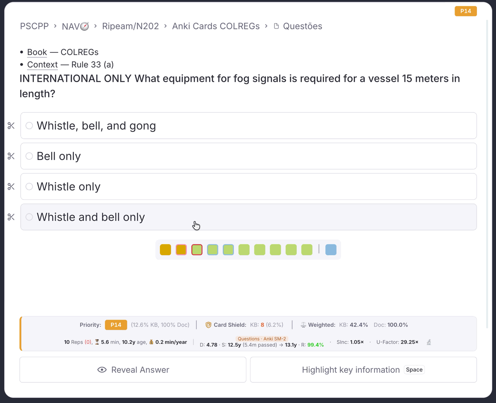
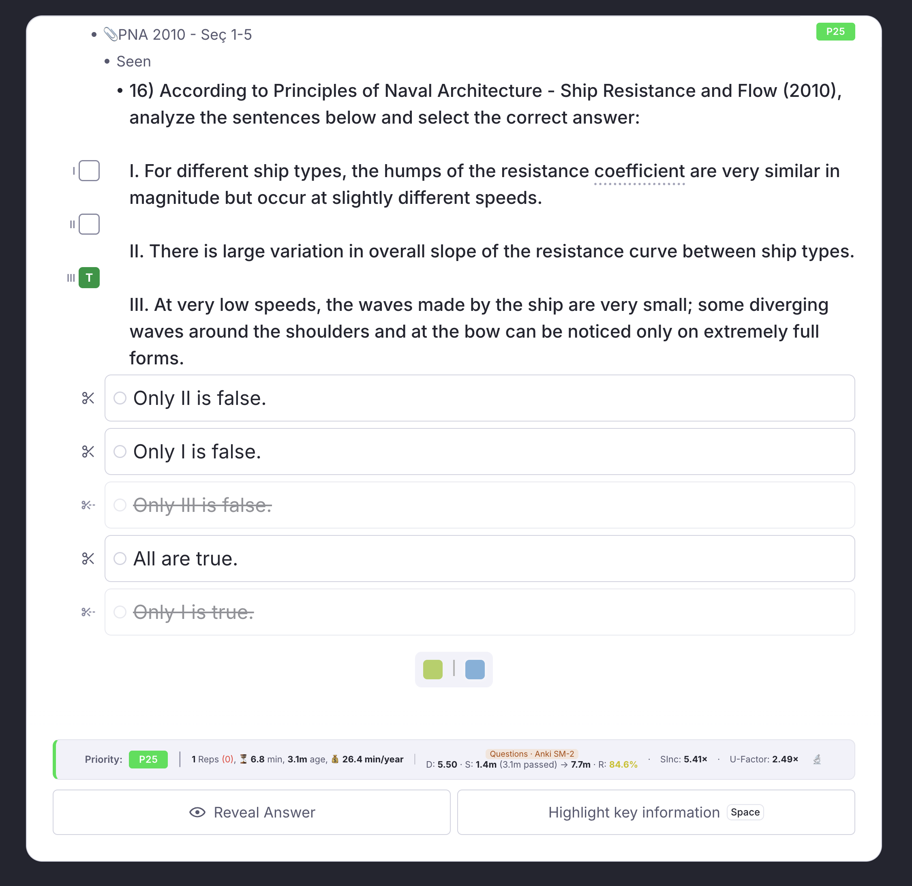

# Multiple-Choice Cards

Additions to RemNote's own multiple-choice cards in the queue: scissors to rule options out, and a True/False answer sheet for questions that ask you to judge numbered statements. Nothing changes in how you create them: write the question, add the options as card items, and the plugin adds to the card as you practise it.

---

## Scissors { #scissors }

Rule options out before you answer, as on a digital exam. Each option of a multiple-choice card gets a ✂ to its left: click it and the option is struck through and dimmed, click it again to bring it back. Clicking an option still answers the card as usual, so you can narrow the choice down first and then pick from what is left.

{ width="900" }

- The scissors follow their options when the card scrolls or the window is resized, and an option scrolled out of view takes its ✂ with it.
- Struck options are only a visual aid: they are not saved, and they clear when the next card comes up.
- Works in both the Compact and the Beautiful queue.
- The scissors are on by default. Turn them off in **IR Settings → Queue Display → Scissors on Multiple-Choice Cards**; the change applies from the next card.

---

## True/False answer sheet { #answer-sheet }

Many exam questions list statements and ask which are true: *"Analyze the sentences below… I. … II. … III. …"*, with options such as *"Only II is false."* On paper you would write T or F next to each one. When a multiple-choice question numbers its statements this way, a column with one box per statement appears beside it: click a box to mark it **T** (green), again for **F** (red), and again to clear it. Then pick the option that matches your verdicts.

{ width="700" }

- **Which questions get it**: the statements must be in the question itself, each on its own line and starting with a roman numeral and a full stop or parenthesis, optionally after a bullet: `I. `, `• II. `, `III) `. They must count up from I, and there must be at least two.
- **Where it sits**: in the same left-hand column as the scissors, beside the question, with its boxes spread evenly over the lower part of the question, where the statements usually are. On a short question with many statements the column runs below the question, so the boxes never crowd together.
- Marks are not saved: they clear when the next card comes up.
- On by default. Turn it off in **IR Settings → Queue Display → True/False Answer Sheet on Multiple-Choice Cards**; the change applies from the next card.

---

## Notes { #notes }

- Cards with more than 12 options get no scissors, and questions with more than ten statements show the first ten.
- In a browser without CSS anchor positioning, the scissors and the answer sheet appear at the top right of the window instead of beside the card; the scissors still match the options in order, top to bottom.
