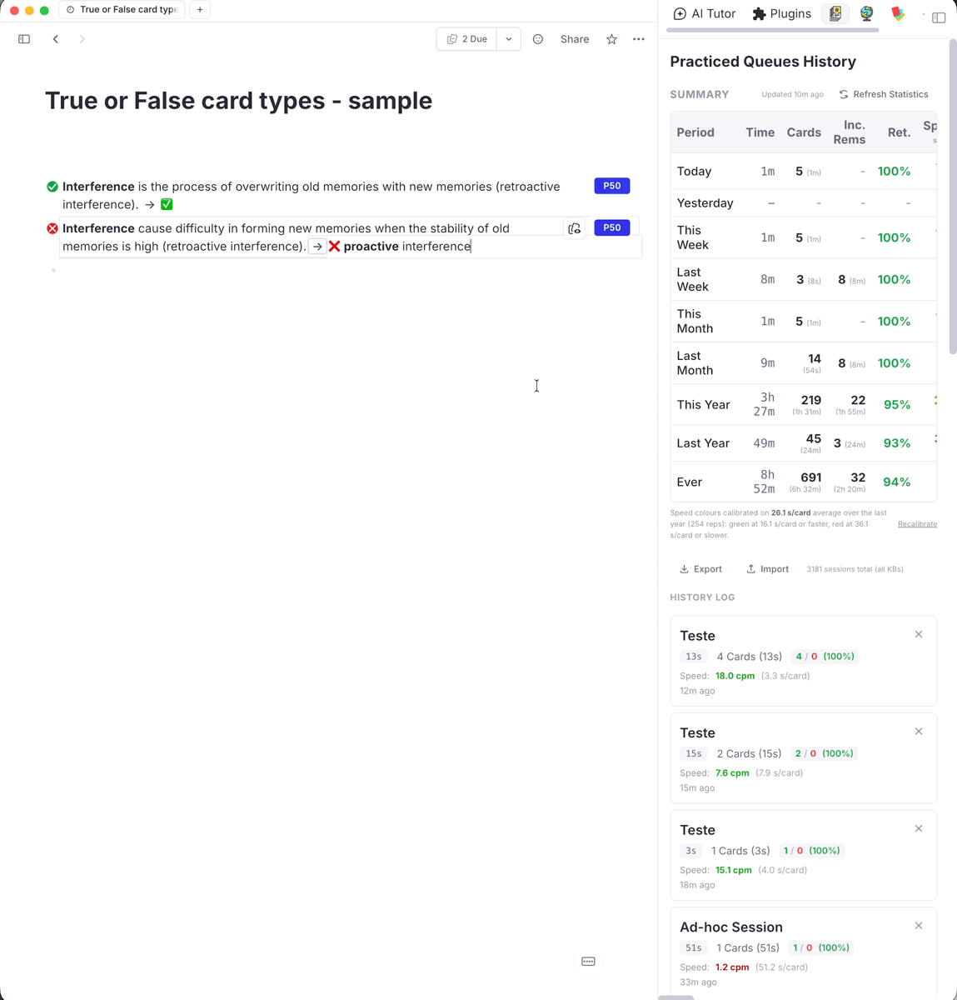
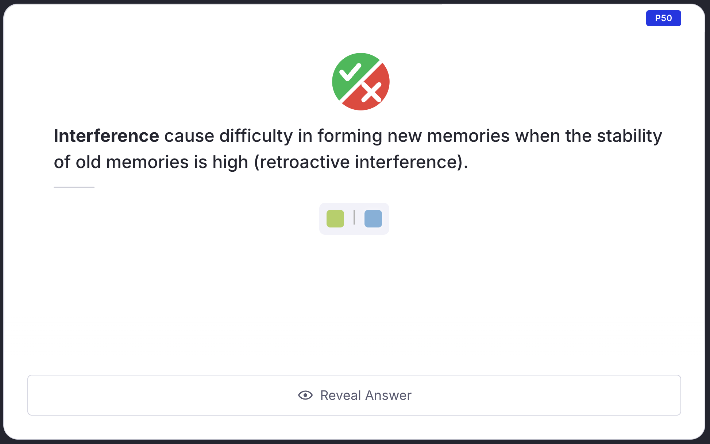
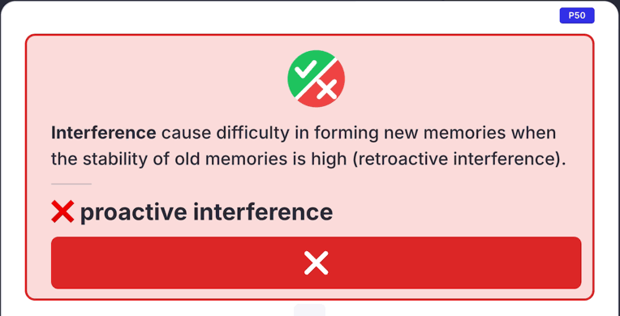
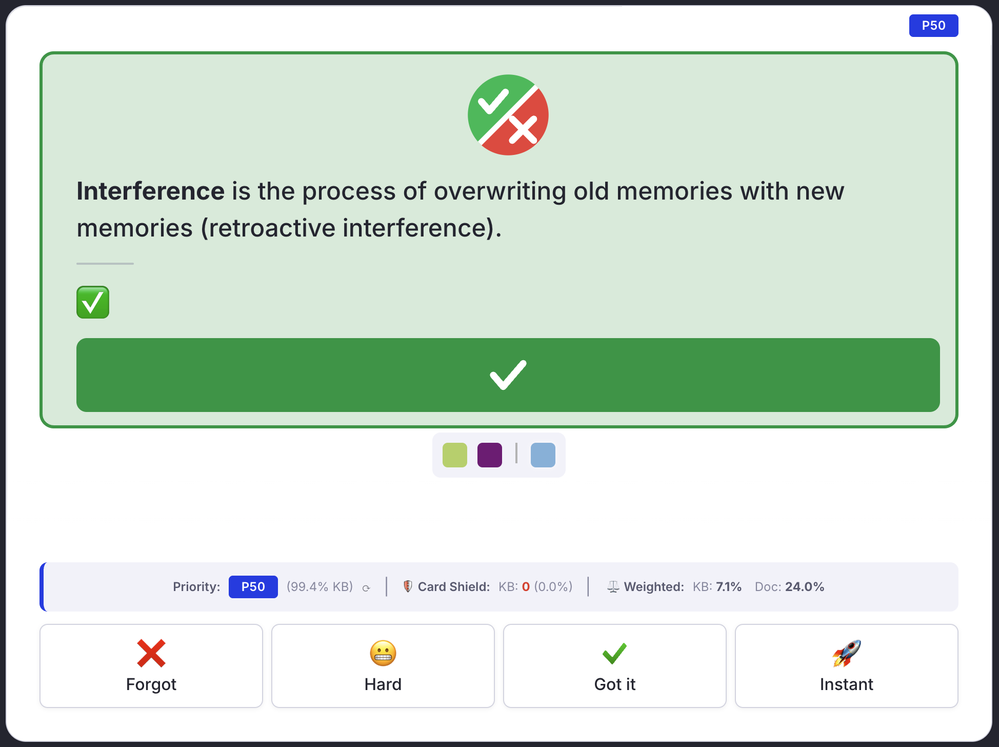
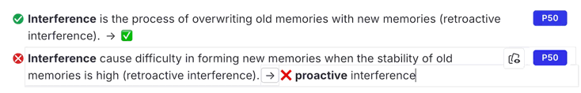

# True or False Cards

Statement cards whose answer is "true" or "false", marked with one command and made unmistakable in the queue. RemNote has no card type for them: you write the statement, type a ✅ or ❌ on the back, and hope to notice in the queue that a verdict is what is being asked.

{ width="900" }

---

## What a True/False card looks like { #what-it-looks-like }

**Front of the card**: a large ✔ / ✘ badge sits above the statement, so the kind of question is obvious before you read it. The badge is the same for true and false statements.

{ width="700" }

**Back of the card**: the statement and its answer sit in a green (true) or red (false) block closed by a full-width ✔ or ✘ bar, and any observation on the back sits on its own line, in a smaller serif type and a softer colour, so a long quotation reads as a note under the statement. The ✅ / ❌ and the "→" are not shown: the bar already gives the verdict. A back holding only the mark shows just the statement and the bar. The colour stays inside the block; the rest of the card is untouched.

{ width="700" }

{ width="700" }

**Editor**: the bullet of the Rem becomes a small green ✔ or red ✘.

{ width="700" }

It works in both the Compact and the Beautiful queue, in light and dark mode.

---

## Mark as True (`tft`) / Mark as False (`tff`) { #mark-as-true-or-false }

Press **`Ctrl+Shift+T`** (Mark as True) or **`Ctrl+Shift+F`** (Mark as False), or run **True/False: Mark as True** / **True/False: Mark as False** from the Omnibar or the `/` menu. `Ctrl` is the Control key on macOS too; on Windows, `Ctrl+Shift+F` is also RemNote's Filter Document, see [Windows Notes](Keyboard-Shortcuts.md#windows-notes). They act on the focused Rem, on every Rem of a multi-Rem selection, or on the current card while you practise.

Each command does two things:

1. **Tags the Rem** with the `TFT` (true) or `TFF` (false) powerup, which is what the styling above is keyed on.
2. **Makes the back say ✅ or ❌**, keeping whatever the back already holds:
    - the right mark is already there, typed or as a reference to a Rem named after it: nothing is written. ✔️, ☑️ and ✓ count as well as ✅, and ✖️ as well as ❌;
    - the opposite mark is there: only that mark is swapped;
    - no mark: one is put in front of the existing back text, so explanations, references, links and pins stay as they are;
    - the Rem has no back: it becomes a forward-only card whose back is the mark.

The mark stays on the back and in the editor; only the queue hides it. So the verdict is still there if the plugin is not installed, for example on a shared or exported card.

Run the other command on a card to flip its verdict.

---

## Judge by Emoji (`tfj`) { #judge-by-emoji }

Already have cards with ✅ or ❌ on the back? Press **`Ctrl+Opt+Shift+J`** (`Ctrl+Alt+Shift+J` on Windows; `Ctrl` is the Control key on macOS too) or run **True/False: Judge by Emoji** to mark them all from that emoji, instead of one by one.

**What is judged:**

- The focused Rem **and everything under it**. If it has descendants, you first see how many candidates were found and how many would be marked true and false.
- With several Rems selected, only those Rems, without asking unless a card was judged by a word.
- While you practise, only the card on screen.

**What counts as a candidate:** a question card (forward and/or backward, not a concept or descriptor) with no clozes and with a verdict on the back:

- **A mark** anywhere on the back, typed or as a reference to a Rem named after it. ✅, ✔️, ☑️ and ✓ mean true; ❌ and ✖️ mean false.
- **If there is no mark, a word**: *true*, *verdadeiro* or *verdadeira*; *false*, *falso* or *falsa*, in any case. It must be a whole word, so *untrue* or *falsos* do not count, but it can be anywhere in the back, even inside an explanation. A reference counts only if the Rem's whole name is that word.

**What is skipped:** every other Rem, cards already tagged to match their emoji, and backs saying both true and false, which are left for you to decide. A mark outranks the words, so *✅ the false claim was corrected* is true.

**Cards judged by a word always ask first**, wherever you ran the command, because "a false premise" is not a verdict. The popup lists each of them with its front, its whole back with the word in bold, and the verdict it would get, all ticked. Untick the wrong ones and press **Mark**; cards judged by a mark are marked along with them.

| Key | Action |
| :--- | :--- |
| `↑` / `↓` | Move through the cards and buttons |
| `Space` | Tick or untick the card |
| `←` / `→` | Go to the buttons, and between them |
| `Enter` | Mark the ticked cards (or press the button you are on) |
| `Esc` | Cancel |

A card tagged one way whose back now says the opposite gets its tag flipped. A back with a mark is not changed; one judged by a word gets the ✅ or ❌ in front, as Mark as True / False would write, and the word stays.

---

## Remove Marking (`tfx`) { #remove-marking }

**True/False: Remove Marking** takes the tag off the selected Rems. The card and its back text are left as they are; only the styling goes.

---

## Importing True/False cards from text (`tfc`) { #importing-from-text }

RemNote's [text import](https://help.remnote.com/en/articles/9252072-how-to-import-flashcards-from-text) cannot name a powerup: `#[[TFT]]` creates an ordinary tag Rem called *TFT* instead. Write the cards with that tag anyway, then convert them:

```
- The master may relieve one of the pilots >> ✅ #[[TFT]]
- No other route may be displayed >> ❌ only the selected one is highlighted #[[TFF]]
```

1. Paste the text into RemNote.
2. Put the cursor on the parent of the pasted cards, or select them.
3. Run **True/False: Convert Pasted Tags** (`tfc`).

The command swaps each plain `TFT` / `TFF` tag for the powerup, writes the ✅ / ❌ mark where the back lacks it, and deletes the plain tag Rem once nothing else uses it. It covers the selected Rems, or the focused Rem and everything under it.

---

## In a Card Cluster { #card-clusters }

A common layout is one question Rem ("mark each item true or false") with the statements as its children, the parent being a **Card Cluster**. Mark each statement with `tft` / `tff` as usual.

In the queue, the statement being tested gets the badge and, once revealed, the green or red block with its answer and the verdict bar. The other statements of the cluster stay as RemNote draws them, and the styling moves along as you go from one statement to the next.

- The styling appears a moment after each statement loads, not with it.
- In the Compact queue the tested statement loses its bullet; the frame marks it instead.
- A statement with no [card priority](Priorities-for-Flashcards.md) is only styled when it is the first one shown from its cluster.

---

## Notes { #notes }

- Every ✅, ✔️, ☑️, ✓, ❌ and ✖️ on the back of a True/False card is hidden in the queue, including one in the middle of a sentence.
- The `TFT` / `TFF` pill is hidden in the editor while it is the Rem's only tag; with several tags RemNote shows its own "2 tags" chip.
- From the queue, the styling of a card you have just marked appears the next time the card is shown.
